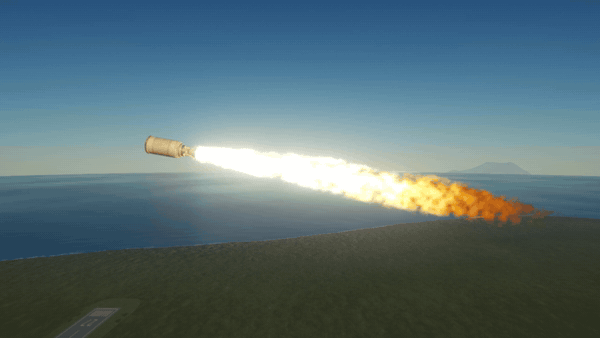
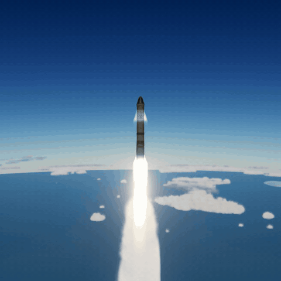

# Engine Flames

A rocket engine's exhaust as burning gas: a blinding white-hot jet that leaves the nozzle, widens, cools out through
yellow into orange tongues, strikes the ground and runs out over it. Worked out bit by bit and drawn as a true
volume, not painted.

For Kerbal Space Program 1.12.x. **Needs two other mods**, each a separate download, and does not load without both:
[Keystone](https://github.com/IshiakiZ/ksp-keystone) 0.9 or later ([on SpaceDock](https://spacedock.info/mod/4665/Keystone)) and
[Volumetric Explosions](https://github.com/IshiakiZ/ksp-volumetric-explosions) 0.8 or later
([on SpaceDock](https://spacedock.info/mod/4669/Volumetric%20Explosions)), in whose air the flame burns.

## What it does

* **Bright, as a rocket's flame is:** white-hot at the nozzle, then yellow, ending in ragged orange tongues.
* **What burns shows:** kerosene and solid fuel blinding, hydrogen a pale veil with shock diamonds in it, a nuclear
  engine a faint red.
* **The air shapes it:** a narrow column at the pad, wider as the air thins, a clear lobe in a vacuum.
* **It moves as fire does:** it wavers, trails when the ship turns, and is turned by the pad, the ground or another
  craft.
* With or without Waterfall: the game's or Waterfall's flame is hidden while this one burns.
* **Starts and stops as real engines do** (0.5.0): the flame builds as an engine lights (a kerosene engine with its igniter's green flash, a solid motor in a burst), falls back as it stops, flickers as the tanks run dry; a jet's afterburner as a thin flame with a row of shock diamonds; a vacuum engine's bell glowing red-orange through a long burn.

## Install

Copy the `EngineFlames` folder from the download into your KSP's `GameData`, beside `Keystone` and
`VolumetricExplosions`.

## Settings

In the Keystone window (the keystone button on the game's toolbar, or Alt-K; Option-K on a Mac): how bright, long
and wide the flame is, whether it lights what is round it and burns in a vacuum, and whether the game's own flames are
hidden.

## Good to know

* Rocket engines and jets' afterburners. Dry jets, ion engines and engines that burn something it does not know keep the flames they had.
  [Flames for other mods' engines](https://github.com/IshiakiZ/ksp-engine-flames/wiki/Other-engines).
* It lights the smoke of [Rocket Smoke](https://github.com/IshiakiZ/ksp-rocket-smoke); the light on ship and ground is
  [Natural Light](https://github.com/IshiakiZ/ksp-natural-light)'s.
* The flame costs less than the flames it hides, where it was measured.
* **No re-entry fire in 0.5.0:** 0.4.0's is taken out while it is made again; until it is back, the game's own re-entry
  streaks show.

## Works on

Mac: tried. Windows 11: tried on Direct3D 11, all but 0.5.0's starts and stops (the Mac only so far). Linux: never run.

**More:** [the long description](https://github.com/IshiakiZ/ksp-engine-flames/wiki/The-long-description) (everything in full, and what
was tried on each system) and the rest of the [wiki](https://github.com/IshiakiZ/ksp-engine-flames/wiki).

## Licence

[CC BY 4.0](LICENSE): use it, change it and pass it on as you like, as long as you credit Ishiaki and link back here.
