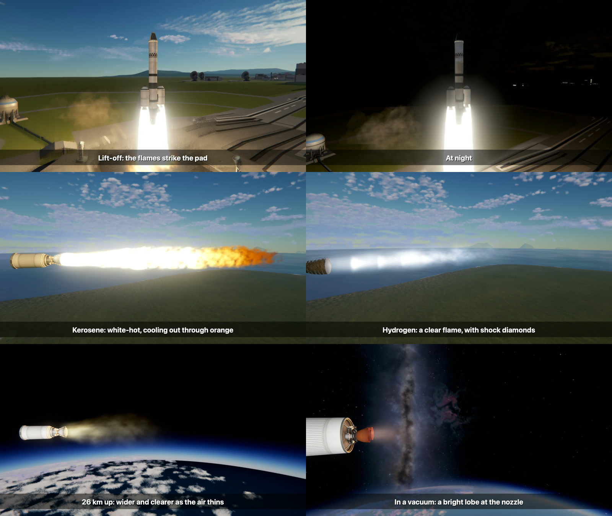
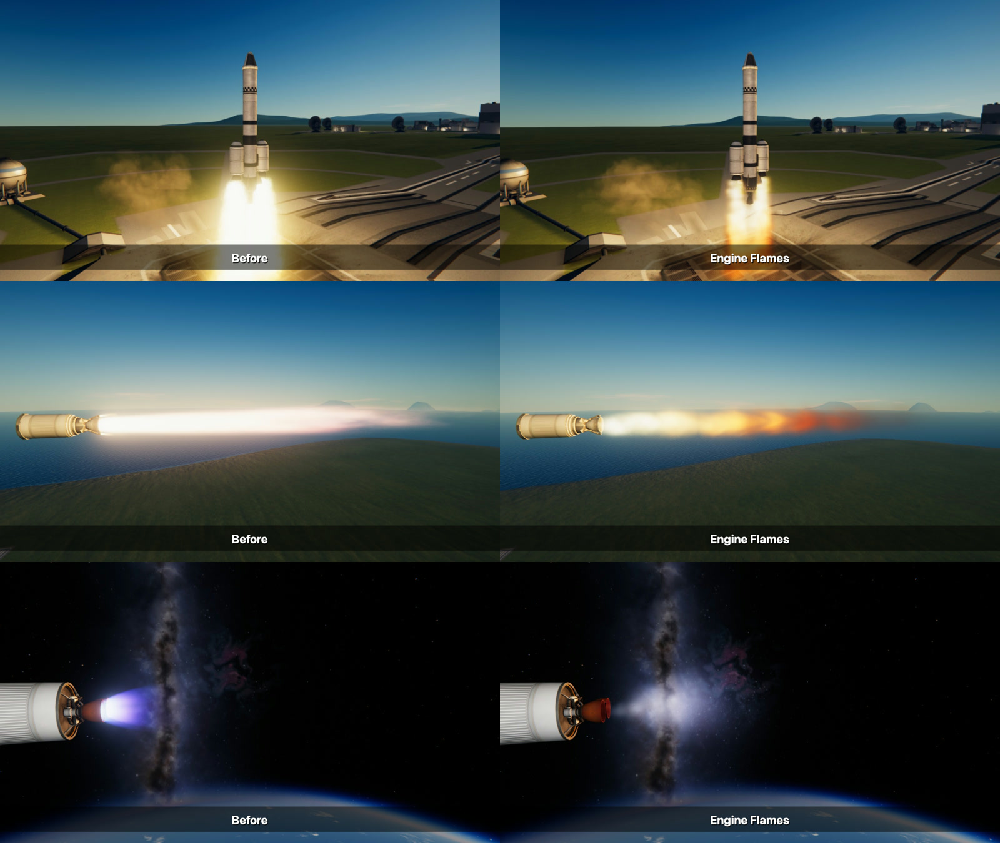

# Engine Flames

A rocket engine's exhaust as burning gas: it leaves the nozzle, is slowed and stirred by the air, widens,
cools from white through yellow to orange, strikes the ground and runs out over it. Worked out bit by bit
and drawn as a true volume, the way [Volumetric Explosions](https://github.com/IshiakiZ/ksp-volumetric-explosions) makes its
fire, in whose air it burns.

For Kerbal Space Program 1.12.x. Needs [Volumetric Explosions](https://github.com/IshiakiZ/ksp-volumetric-explosions) 0.4.0 or
later (0.5.0 for the look described below as fire, tongues and diamonds) and [Keystone](https://github.com/IshiakiZ/ksp-keystone);
both come in the download. It works beside the Waterfall mod
or without it: while one of its flames burns for an engine, the flame the game or Waterfall draws for that
engine is hidden, and the smoke is left.

**It is made for the game's OpenGL (a Mac, Linux).** Volumetric Explosions draws its fire with a shader
made for that. On Windows (Direct3D) there is none yet: the mod says so in its settings and leaves the
game's flames as they are.

## What it does

* **Worked out, not drawn.** A flame is some hundreds of bits of gas for each nozzle, each moved, widened,
  stirred and cooled frame by frame, and all of them drawn as one lit volume. Its edge, its flicker and
  its reach are what the gas did: nothing of its shape is laid down beforehand.
* **Fire, not a glow** (with Volumetric Explosions 0.5.0). Its pattern holds its place on the nozzle and flows
  down the jet: tongues torn at its edge, streaks along it, a white-hot core in a yellow and orange sheath,
  soot in a kerosene flame, a few shock diamonds in a hydrogen one. (Before, it was "kind of just like
  blurred color", in the words of the first person to see it.)
* **The air shapes it.** A narrow torn column at the pad; wider and paler as the air thins; a smooth pale
  bell in a vacuum. It changes all the way up, not in steps.
* **It strikes the ground.** The flame of a rocket on its pad is turned by the pad and runs out over it
  as a sheet of fire; it does the same on a building, the ground or another craft.
* **It stays on its nozzle.** The air it burns in goes along with the ship, so the flame is as steady at
  nine hundred metres a second as on the pad, and is swept back when the ship flies aslant.
* **What burns shows.** Kerosene white, yellow and orange; hydrogen pale blue and nearly without light; the
  small upper-stage engines blue-white; solid boosters brilliant; a nuclear engine a faint red.

*Each pair is one craft at one place, each picture taken in a scene loaded afresh, with the camera's
exposure held still. "Before" is this install as it was: the game's own flames on the solid boosters and
the Waterfall mod's on the liquid engines. The smoke in all of them is the game's.*

## Install

Copy the `Keystone`, `VolumetricExplosions` and `EngineFlames` folders from the download's `GameData` into
your KSP `GameData`.

## Settings

In the Keystone window (the keystone button on the game's toolbar, or Option-K on a Mac, Alt-K elsewhere).

| Setting | Installed as | |
| --- | --- | --- |
| Engine flames | on | off: the flames the game (or Waterfall) draws |
| How bright | 1 | |
| How long | 1 | |
| How wide | 1 | a nozzle's width is measured from the engine's model; this corrects it |
| Hide the game's own flames | on | off: both are drawn |

## Good to know

* Rocket engines only. Jets, ion engines and engines that burn something it does not know keep the flames
  they had.
* The game has one fuel for every liquid engine. Which real fuel each of the game's engines is taken as
  burning is the mod's own choice, by the engine each was modelled on; a config can say otherwise for any
  part, and say it for other mods' engines. See [flames for other engines](docs/Other-engines.md).
* No shock diamonds. The first version, which drew its flames as shapes, drew them; gas worked out in
  bits does not form them.
* It gives off no light of its own on the ship or the ground (the [Natural Light](https://github.com/IshiakiZ/ksp-natural-light)
  mod's engine lamps do that); it does light the smoke of [Rocket Smoke](https://github.com/IshiakiZ/ksp-rocket-smoke), which
  is made to go with it.
* It costs about what the flames it hides cost. A Kerbal X (seven engines) left the pad at 39 frames a
  second with the game's and Waterfall's flames and at 42 with these, and climbed at 45 and at 49 (one
  flight each way, on an Apple M5 Pro at 1280 by 720, with Scatterer, EVE, TUFX and Natural Light).
* Made on 2026-10-09 and looked at in pictures and frame by frame: on a test stand from the pad to a
  vacuum, at lift-off by day and night, and on climbs to thirty kilometres. Nobody has played with it yet.
* Made and tried on a Mac. Linux uses the same OpenGL shader and should work, but it has **not been run**
  there. On Windows it does nothing yet (see above).

More: [how it works](docs/How-it-works.md).
